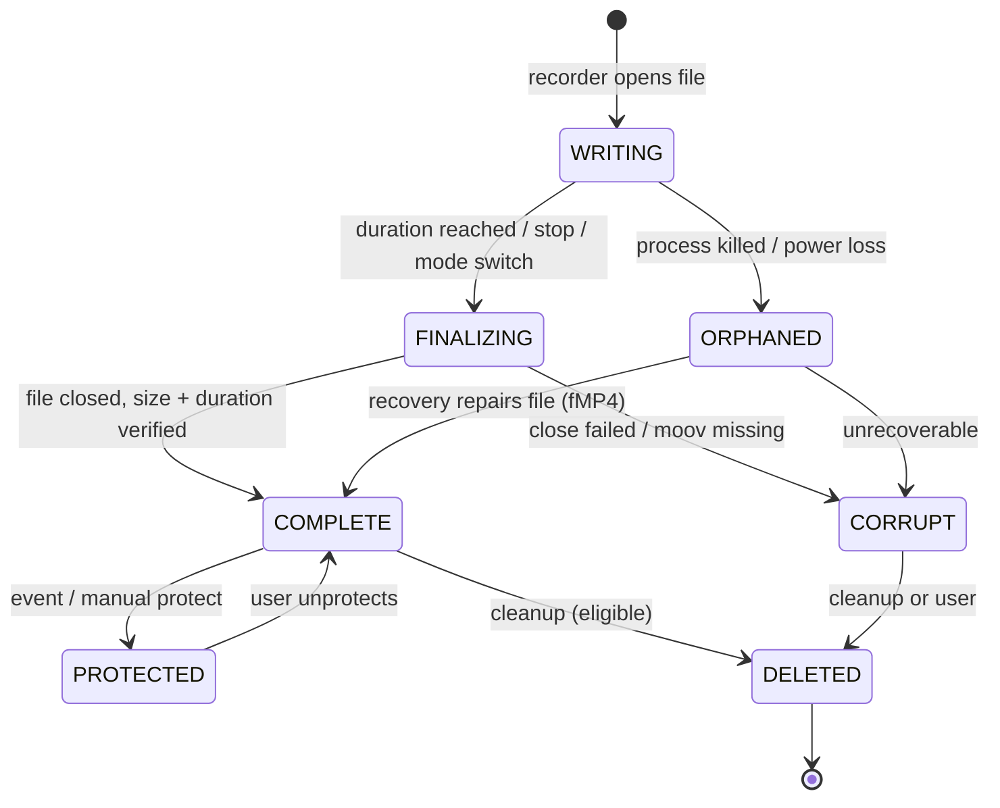

# 02 — Smart Loop recording engine

The recording engine is the core of FRAME. Dashcam, Sports and Pro Camera are all *profiles* on top of it. The engine records video into short, independent segment files and keeps an index of them in a database. A separate cleanup worker deletes segments that have expired or that must go to keep free space, but **never** a protected segment or the one currently being written.

## Segment lifecycle



| State | Can cleanup delete it? | Notes |
|---|---|---|
| `WRITING` | **Never** | Exactly one per active session |
| `FINALIZING` | **Never** | Lasts at most a few hundred ms |
| `COMPLETE` | Yes, if it has expired or space is needed | The normal state |
| `PROTECTED` | **Never automatically** | Only the user can delete it, with confirmation |
| `ORPHANED` | No (recovery runs first) | Found at startup |
| `CORRUPT` | Yes | Shown in cleanup history so the user knows |

## Retention policy

Each recording profile (Dashcam, Sports, Camera) has its own policy. A global storage reserve applies on top of all of them.

| Setting | Options | Default (Dashcam) | Default (Sports) |
|---|---|---|---|
| Delete unprotected footage older than | 12 h, 24 h, 3 days, 7 days, custom, never | 3 days | Never |
| Segment length | 1, 3, 5, 10 min | 3 min | 5 min |
| Reserve free storage | 5%, 10%, 15%, 30%, or fixed GB | 10% | 10% |
| Max storage for this mode | Off, or N GB | 32 GB | Off |
| Never auto-delete protected clips | Always on (it can't be turned off in the POC) | On | On |
| Event buffer (before / after) | 10–120 s / 10–120 s | 30 s / 30 s | 20 s / 10 s |
| When the budget can't be met | Stop recording / Keep recording and warn | Warn, then stop | Warn, then stop |

Policy summary shown to the user, for example:

> Keep unprotected recordings for **3 days**, split footage into **3-minute** files, and keep **10%** of storage free. Protected recordings are never deleted automatically.

## Cleanup triggers

Cleanup runs when:

1. A segment finishes (`COMPLETE`). This is the main trigger while recording.
2. A periodic `WorkManager` job runs (every 1 h, and only while not recording). This handles time-based expiry while idle.
3. Free space drops below the reserve plus a safety margin (checked every 15 s while recording).
4. The app starts (after recovery).
5. The user taps "Clean up now" in Storage Manager.

Runs never overlap: one coroutine `Mutex` guards cleanup, and deletes happen on a single-threaded dispatcher.

## Cleanup algorithm

```kotlin
suspend fun runCleanup(now: Instant, reason: CleanupReason) = cleanupMutex.withLock {
    val policy = policyRepo.effectivePolicy()

    // 1. Time-based: delete expired, eligible segments (oldest first)
    segmentDao.eligibleOlderThan(now - policy.maxAge)        // state == COMPLETE || CORRUPT
        .forEach { deleteSegment(it, reason = EXPIRED) }

    // 2. Mode budget: delete oldest eligible until under the per-mode cap
    for (mode in Mode.values()) {
        while (segmentDao.bytesFor(mode) > policy.maxBytes(mode)) {
            val oldest = segmentDao.oldestEligible(mode) ?: break
            deleteSegment(oldest, reason = MODE_BUDGET)
        }
    }

    // 3. Free-space reserve: delete oldest eligible across all modes
    val reserve = policy.reserveBytes(storage.totalBytes())
    val nextSegment = estimator.bytesForNextSegment()        // bitrate × segment length
    while (storage.freeBytes() < reserve + nextSegment) {
        val oldest = segmentDao.oldestEligible() ?: return@withLock budgetCannotBeMet()
        deleteSegment(oldest, reason = LOW_SPACE)
    }
}

// Eligible = state in (COMPLETE, CORRUPT) AND not protected AND not part of an open event window
```

`deleteSegment` does these steps in order:

1. In one DB transaction, mark the row as `DELETING`. This stops the UI from opening it.
2. Delete the file, then the thumbnail.
3. Mark the row `DELETED` and write a `CleanupLog` row (file, size, reason, time).
4. If deleting the file fails, roll the row back to its earlier state, log the error, and continue with the next candidate.

### When the budget cannot be met

When only protected or active segments are left and space is still below the reserve:

1. A high-priority notification says: "Storage full — protected clips use 18 GB. Recording will stop in 2 minutes unless space is freed."
2. Keep recording until free space reaches a **hard floor** (the larger of 500 MB and 2 segments).
3. At the hard floor, finalize the current segment cleanly and stop. Never delete protected content.
4. Log a `RecordingStopped(reason = STORAGE_FULL)` event.

## Event buffer (protection window)

Recording never stops, so the footage *before* an event is already on disk in the earlier segments. To protect an event, the engine marks every segment that overlaps `[eventTime − before, eventTime + after]`.

```
time ──────────────────────────────────────────────────────────►
segments  | seg 41 | seg 42 | seg 43 | seg 44 | seg 45 |
event                       ▲ t = 12:04:10
window               [11:03:40 ─────────── 12:04:40]   (30 s / 30 s)
protected            seg 42 , seg 43                  (seg 44 too if the window crosses into it)
```

- If the window extends into the future, the event stays **open** until `eventTime + after`. Segments created while it is open are protected as they finish.
- Overlapping events merge into a single window.
- **Clip extraction** (optional, runs in the background): Media3 Transformer cuts the exact window into one `event_*.mp4`, so the user gets one file instead of 2–3 segments. After extraction the source segments can be unprotected, and this behavior is configurable.

## Segment switching: two options

To be decided in the Week 1 spike:

| | Option A: CameraX stop/start | Option B: custom encoder + rotating muxer |
|---|---|---|
| How | `Recording.stop()` then `prepareRecording(newFile).start()` on finalize | Camera2/CameraX `Preview` → `MediaCodec` encoder surface → write samples; switch muxer at the next keyframe |
| Gap between segments | About 0.3–1 s of lost footage | 0 frames lost |
| Crash safety | Plain MP4: the last segment is unplayable if killed | Media3 `FragmentedMp4Muxer`: playable up to the last fragment (about 1–2 s) |
| Effort | Low (about 2 days) | High (about 2 weeks), including audio/video sync |
| Recommendation | Build first, to get the app working end to end | Build in Week 3–4. Gapless recording matters for dashcam evidence. |

Alternative for Option A: `MediaRecorder.setNextOutputFile()` (API 26+) switches files seamlessly, but only at *size* limits, not at duration limits. It can be used with a size-per-segment estimate.

## Crash recovery

At app start, and when the recording service starts:

1. Scan `recordings/` for files with no matching DB row, and for rows whose state is `WRITING` or `FINALIZING`.
2. For each one: if it's fMP4, truncate it to the last complete fragment and mark it `COMPLETE`. If it's plain MP4 with no `moov` box, mark it `CORRUPT`.
3. Rebuild any missing DB rows from file names and `metadata.json` sidecars. The DB is a cache; the files plus sidecars are the source of truth.
4. If the last session ended unexpectedly *and* the profile has "resume after crash" turned on, show a notification offering to resume recording. The OS does not allow restarting the camera silently from the background (see [09](09-platform-limits-and-risks.md)).

## Recording health monitor

A watchdog inside the service checks every 5 s:

| Check | Threshold | Action |
|---|---|---|
| Frames written in the last 5 s | Less than 50% of the target FPS | Warning; after 3 failed checks in a row, restart the camera session |
| Free space | Below reserve + 1 segment | Trigger cleanup |
| Device thermal status (`PowerManager.getCurrentThermalStatus`) | `SEVERE` or higher | Drop to the lower profile (for example 1080p30 → 720p30); notify |
| Thermal status | `CRITICAL` | Finalize and stop; notify |
| Battery | Below 15% and not charging | Notify; stop at 5% |
| Camera error (`CameraState.ERROR`) | Any | Retry 3 times with backoff, then stop and notify |

Every health event is written to a `RecordingEvent` row, so the user (and testers) can see a timeline of what happened during a session.
