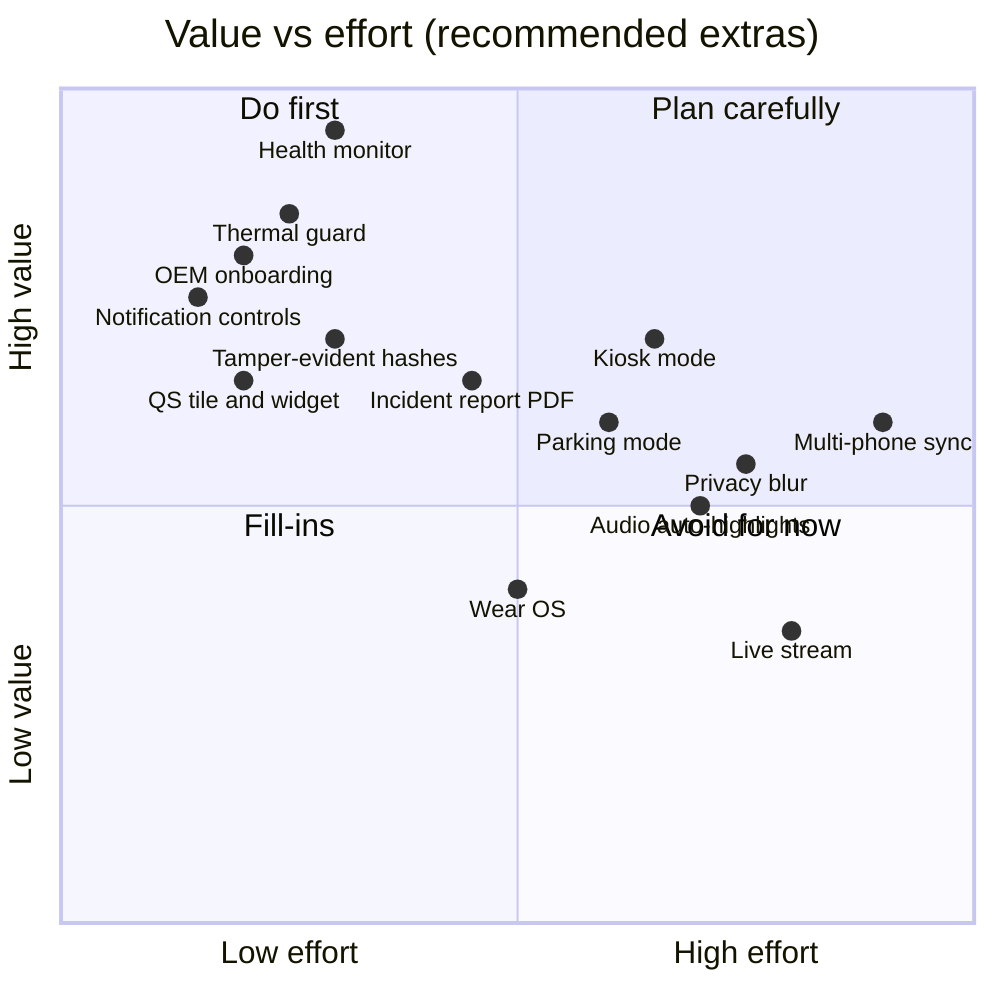

# 06 — Extra features (recommended)

These features go beyond the original vision. They're split into **required**, meaning a recorder of this kind isn't trustworthy without them, and **cool**, meaning they set FRAME apart. Each one is tagged with when to build it.

## Required

| Feature | Why it matters | When |
|---|---|---|
| **Recording health monitor** | The worst failure for a dashcam is when it *silently stopped* recording. A watchdog checks frames, space, heat and camera errors every 5 s. | POC |
| **Thermal and battery guard** | Phones on a sunny windshield overheat. Step down quality automatically before the OS kills the camera. | POC |
| **Permission and OEM onboarding** | Xiaomi, Samsung, Huawei and others kill background apps aggressively. A guided setup checks battery optimization exemption, autostart and notification permission, with OEM-specific steps (the [dontkillmyapp.com](https://dontkillmyapp.com) approach). | POC |
| **Persistent notification controls** | Stop, Save and Highlight buttons in the foreground-service notification, which also works from the lock screen. | POC |
| **Quick Settings tile + home-screen widget** | Start the dashcam with one tap without opening the app. User interaction is also what Android 14+ requires to start a camera FGS. | POC |
| **Volume-key and Bluetooth-remote markers** | Save a moment without touching the screen. Cheap BT selfie remotes send volume-up. | POC |
| **Crash-safe files** | Fragmented MP4, so a power cut loses at most about 1–2 s instead of a whole segment. | POC (Option B) |
| **Uninstall-loss protection** | Warn that app-specific storage is deleted on uninstall; one-tap "Export protected clips". | POC |
| **Diagnostics log + export** | Per-session event timeline (start, stops, thermal, errors) that can be shared as a zip. Essential for testing on many devices. | POC |
| **App lock (PIN / biometric) for the library** | Recordings show where you've been and who you were with. | Phase 2 |
| **Audio on/off per mode + legal notice** | Audio consent laws differ by country and state. | POC |
| **Accessibility** | Large touch targets, TalkBack labels, haptic confirmation for Save/Highlight | POC (basics) |

## Cool

| Feature | What it does | When |
|---|---|---|
| **Tamper-evident evidence** | SHA-256 hash of each finished segment, chained to the previous segment's hash and stored in metadata. An exported incident can be proven unmodified, which is useful for insurance claims and police reports. | Phase 2 |
| **Incident report PDF** | One tap creates a PDF with time, address, map snapshot, speed graph, g-force peak, hash and a QR code / link to the clip. | Phase 2 |
| **Parking mode (time-lapse)** | When parked on power: 1 frame/s time-lapse, plus a full-rate burst when the G-sensor detects a bump | Phase 2 |
| **"Old phone as dashcam" kiosk mode** | Turn a spare phone into a dedicated dashcam: auto-launch, screen-off recording, starts on power. Uses device-owner / home-app mode to get past background limits. | Phase 2 |
| **Privacy blur on export** | Automatically blur faces and number plates when sharing (ML Kit face detection + a plate detector). The original stays untouched. | Phase 5 |
| **Auto highlights from audio** | Detect crowd cheers or whistles (audio energy peaks plus a small on-device classifier) and suggest highlight markers after the match. | Phase 5 |
| **Score-change auto-highlights** | Every score change in Sports mode automatically creates a highlight. No extra tap. | Phase 2 |
| **Wear OS companion** | A watch tile with Highlight and Save buttons, ideal for coaches and parents on the sideline | Phase 3 |
| **Multi-phone match sync** | 2–4 phones film one match, with a shared match clock over Wi-Fi Direct; highlights on one phone are marked on all of them. Later, a multi-angle highlight reel. | Phase 5 |
| **Quick share to a nearby device** | Send a highlight to a teammate's phone through Quick Share / Wi-Fi Direct, with no internet needed | Phase 2 |
| **Smart storage forecast** | "At this rate the dashcam will start deleting 3-day-old footage in 2 days", based on real usage | Phase 2 |
| **Trip summaries** | Each drive: distance, duration, max speed, route map, events | Phase 2 |
| **Recording profiles + schedules** | For example "Weekday commute": 1080p30, no audio, 24 h retention, auto-start on the car's Bluetooth | Phase 3 |
| **Speech-to-text search** | On-device transcription of audio, so you can search "where did I say 'license plate'" | Phase 5 |
| **Live stream (RTMP)** | Stream a local match to YouTube while also recording locally | Phase 5 |

## Feature priority matrix

> Positions are judgment calls to prioritize discussion, not measured estimates.
