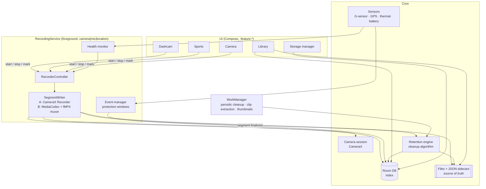

# 07 — Architecture and tech stack

FRAME is a native Android app with a modular, layered architecture. The recording engine runs inside a **foreground service** so it survives the UI going away. All UI modes talk to it through one `RecorderController` interface. The database indexes the files, but **the files plus their JSON sidecars are the source of truth**, so the index can always be rebuilt.

## Tech stack

| Concern | Choice | Notes |
|---|---|---|
| Language | Kotlin 2.x | Coroutines + Flow everywhere |
| UI | Jetpack Compose + Material 3 | Navigation Compose |
| Camera | CameraX 1.4+ (`camera-core`, `camera-camera2`, `camera-video`, `camera-effects`) | Camera2 interop for FPS ranges, physical lenses, manual controls |
| Encoding (Option B) | `MediaCodec` + Media3 `media3-muxer` (`FragmentedMp4Muxer`) | Gapless, crash-safe segments |
| Playback | Media3 ExoPlayer | Playlist of segments with seamless playback |
| Editing / export | Media3 Transformer | Trim, concatenate, overlays, presets |
| Database | Room (SQLite) | Migrations tested from day 1 |
| DI | Hilt | |
| Background | Foreground service (`camera\|microphone\|location`) + WorkManager | Periodic cleanup, clip extraction, thumbnails |
| Location | Play Services `FusedLocationProviderClient` | 1 Hz while recording |
| Sensors | `SensorManager` (`TYPE_LINEAR_ACCELERATION`) | 50 Hz, only while recording |
| Settings | DataStore (Proto) | Policies and profiles |
| Logging | Timber + a rolling file logger | Exportable diagnostics |
| Crash reporting | Optional, opt-in (for example Firebase Crashlytics) | Off by default; local-first promise |
| Testing | JUnit5, Turbine, Robolectric, Compose UI tests, Macrobenchmark | Plus long-run device tests |
| Optional backend (Phase 5) | Spring Boot + PostgreSQL + S3-compatible object storage | Accounts, opt-in backup, shared sports events |

## Module layout (Gradle)

```
:app                       – Application, navigation, DI graph, onboarding
:core:model                – Plain Kotlin models (Segment, Session, Event, Policy…)
:core:domain               – Use cases (StartRecording, MarkEvent, RunCleanup, ExportClip…), no Android types
:core:data                 – Room DB, DAOs, repositories, DataStore
:core:storage              – File layout, StatFs, sidecar JSON, recovery scanner
:core:camera               – CameraX session, use-case binding, capabilities probe
:core:recording            – RecorderController, SegmentWriter (A/B), RecordingService, health monitor
:core:retention            – Policy engine, cleanup algorithm, CleanupWorker
:core:sensors              – G-sensor detector, location tracker, thermal/battery monitors
:core:media                – Player helpers, Transformer export, thumbnails
:core:ui                   – Design system, shared Compose components
:feature:dashcam           – Dashcam screen, HUD, auto-start receivers
:feature:sports            – Match setup, scoreboard, highlight UI
:feature:camera            – Photo/video UI
:feature:library           – Library, player, trim/export
:feature:storage           – Storage dashboard, policies, cleanup history
:feature:settings          – Settings, diagnostics, OEM guidance
```

## Component diagram



## Threading model

| Work | Dispatcher / thread |
|---|---|
| Camera callbacks | CameraX executor (one dedicated `HandlerThread`) |
| Encoding + muxing (Option B) | One dedicated thread per encoder (video, audio) + a single muxer writer thread |
| Segment finalize + DB writes | `Dispatchers.IO` limited to 1 (`limitedParallelism(1)`) to keep ordering |
| Cleanup | A single-threaded dispatcher + `Mutex` |
| Sensors | `SensorManager` on its own `HandlerThread`; events posted into a Flow |
| UI | Main; it observes `StateFlow<RecorderState>` |

## RecorderController API (sketch)

```kotlin
interface RecorderController {
    val state: StateFlow<RecorderState>          // Idle, Preparing, Recording(session, segment, elapsed), Stopping, Error
    val health: StateFlow<HealthStatus>

    suspend fun start(profile: RecordingProfile): Result<SessionId>
    suspend fun stop(reason: StopReason = StopReason.USER)
    suspend fun markEvent(type: EventType, source: EventSource): EventId   // protect / highlight
    suspend fun switchCamera(lens: LensId)                                 // finalizes segment, continues session
    fun attachPreview(surfaceProvider: Preview.SurfaceProvider?)           // null when UI goes away
}
```

The UI binds to the service. Preview is a use case that is attached when a screen is visible and detached when it isn't, while `VideoCapture` stays bound. That way recording continues with the screen off and the preview costs no power.

## Key Android manifest entries

```xml
<uses-permission android:name="android.permission.CAMERA"/>
<uses-permission android:name="android.permission.RECORD_AUDIO"/>
<uses-permission android:name="android.permission.ACCESS_FINE_LOCATION"/>
<uses-permission android:name="android.permission.FOREGROUND_SERVICE"/>
<uses-permission android:name="android.permission.FOREGROUND_SERVICE_CAMERA"/>
<uses-permission android:name="android.permission.FOREGROUND_SERVICE_MICROPHONE"/>
<uses-permission android:name="android.permission.FOREGROUND_SERVICE_LOCATION"/>
<uses-permission android:name="android.permission.POST_NOTIFICATIONS"/>
<uses-permission android:name="android.permission.WAKE_LOCK"/>
<uses-permission android:name="android.permission.REQUEST_IGNORE_BATTERY_OPTIMIZATIONS"/>
<uses-permission android:name="android.permission.BLUETOOTH_CONNECT"/>

<service
    android:name=".recording.RecordingService"
    android:foregroundServiceType="camera|microphone|location"
    android:exported="false"/>
```

> `REQUEST_IGNORE_BATTERY_OPTIMIZATIONS` is restricted by Play policy. Dashcam-style continuous recording is a reasonable justification, but it needs a declaration in the Play Console. If it's rejected, the fallback is to send the user to the settings screen manually.
