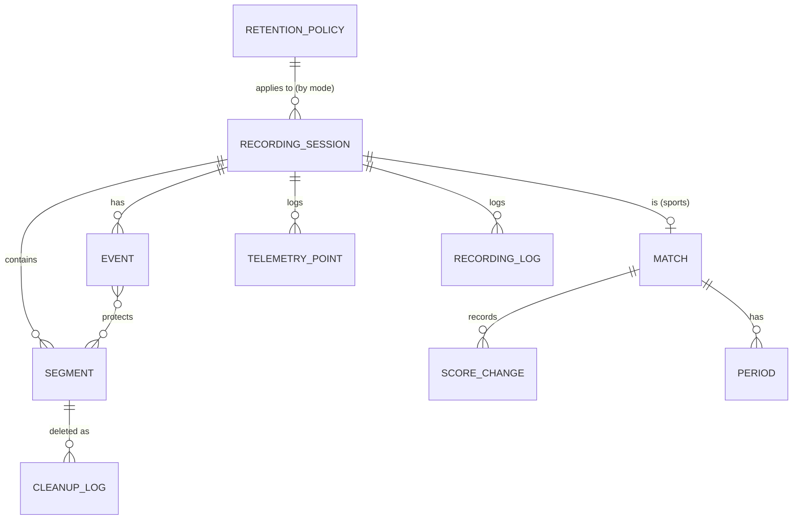

# 08 — Data model

Room (SQLite) indexes every recording. Each segment file also has a `.json` sidecar with the same core fields, so the DB can be rebuilt after corruption, a restore, or a manual file copy.

## Entity relationships



## Entities

```kotlin
enum class Mode { DASHCAM, SPORTS, CAMERA }
enum class SegmentState { WRITING, FINALIZING, COMPLETE, ORPHANED, CORRUPT, DELETING, DELETED }  // "protected" is derived, not a state
enum class EventType { MANUAL, IMPACT, HIGHLIGHT_GOAL, HIGHLIGHT_WICKET, HIGHLIGHT_POINT, HIGHLIGHT_CUSTOM }
enum class EventSource { SCREEN, VOLUME_KEY, BT_REMOTE, NOTIFICATION, G_SENSOR, SCORE_CHANGE, WEAR }

@Entity(tableName = "recording_session")
data class RecordingSession(
    @PrimaryKey val id: String,                 // ULID, sortable by time
    val mode: Mode,
    val profileId: String,
    val startedAt: Long,                        // epoch ms (UTC)
    val endedAt: Long?,
    val endReason: String?,                     // USER, CHARGER_OFF, STORAGE_FULL, THERMAL, CRASH…
    val folderPath: String,
    val videoCodec: String, val width: Int, val height: Int, val fps: Int, val bitrate: Int,
    val audioEnabled: Boolean,
)

@Entity(
    tableName = "segment",
    indexes = [Index("sessionId"), Index("state", "endedAt"), Index("mode", "state", "endedAt")]
)
data class Segment(
    @PrimaryKey val id: String,
    val sessionId: String,
    val mode: Mode,                             // denormalized for fast cleanup queries
    val index: Int,                             // 1-based within session
    val filePath: String,
    val startedAt: Long,
    val endedAt: Long?,
    val durationMs: Long?,
    val sizeBytes: Long?,
    val state: SegmentState,
    val protectedManually: Boolean = false,     // user tapped Protect on the segment itself
    val favorite: Boolean = false,
    val sha256: String? = null,                 // Phase 2: tamper-evident chain
    val prevSha256: String? = null,
    val thumbnailPath: String? = null,
)

@Entity(tableName = "event", indexes = [Index("sessionId"), Index("time")])
data class Event(
    @PrimaryKey val id: String,
    val sessionId: String,
    val type: EventType,
    val source: EventSource,
    val time: Long,
    val windowStart: Long,                      // time - before
    val windowEnd: Long,                        // time + after
    val open: Boolean,                          // true until windowEnd has been recorded
    val peakG: Float? = null,
    val lat: Double? = null, val lon: Double? = null, val speedKmh: Float? = null,
    val label: String? = null,
    val extractedClipPath: String? = null,
)

@Entity(tableName = "event_segment", primaryKeys = ["eventId", "segmentId"],
        indexes = [Index("segmentId")])
data class EventSegmentCrossRef(val eventId: String, val segmentId: String)

@Entity(tableName = "match")
data class Match(
    @PrimaryKey val sessionId: String,
    val sport: String,
    val teamA: String, val teamB: String,
    val venue: String?,
)

@Entity(tableName = "score_change", indexes = [Index("sessionId", "time")])
data class ScoreChange(
    @PrimaryKey val id: String,
    val sessionId: String,
    val time: Long,
    val scoreA: String, val scoreB: String,     // strings to allow "142/3" (cricket)
    val periodIndex: Int,
)

@Entity(tableName = "telemetry_point", indexes = [Index("sessionId", "time")])
data class TelemetryPoint(
    @PrimaryKey(autoGenerate = true) val id: Long = 0,
    val sessionId: String,
    val time: Long,
    val lat: Double, val lon: Double,
    val speedKmh: Float?, val bearing: Float?, val accuracyM: Float?,
)

@Entity(tableName = "cleanup_log", indexes = [Index("time")])
data class CleanupLog(
    @PrimaryKey(autoGenerate = true) val id: Long = 0,
    val time: Long,
    val segmentId: String,
    val filePath: String,
    val sizeBytes: Long,
    val reason: String,                         // EXPIRED, MODE_BUDGET, LOW_SPACE, USER, CORRUPT
    val success: Boolean,
    val error: String? = null,
)

@Entity(tableName = "recording_log", indexes = [Index("sessionId", "time")])
data class RecordingLog(                        // health + lifecycle timeline
    @PrimaryKey(autoGenerate = true) val id: Long = 0,
    val sessionId: String,
    val time: Long,
    val kind: String,                           // SEGMENT_START, THERMAL_SEVERE, CAMERA_ERROR, LOW_FPS…
    val detail: String?,
)
```

Retention policies and recording profiles live in **Proto DataStore**, not in Room. They are small, typed and versioned.

```proto
message RetentionPolicy {
  Mode mode = 1;
  int64 max_age_minutes = 2;          // 0 = never expire
  int32 segment_length_seconds = 3;
  int32 reserve_percent = 4;
  int64 max_bytes = 5;                // 0 = no cap
  int32 event_before_seconds = 6;
  int32 event_after_seconds = 7;
  BudgetAction on_budget_exhausted = 8;  // WARN_THEN_STOP | STOP
}
```

## Key queries

```kotlin
// Eligible for deletion: finished, not protected, not covered by any event
@Query("""
  SELECT s.* FROM segment s
  WHERE s.state IN ('COMPLETE','CORRUPT')
    AND s.protectedManually = 0
    AND NOT EXISTS (SELECT 1 FROM event_segment es WHERE es.segmentId = s.id)
    AND (:mode IS NULL OR s.mode = :mode)
    AND s.endedAt < :olderThan
  ORDER BY s.endedAt ASC
  LIMIT :limit
""")
suspend fun eligible(mode: Mode?, olderThan: Long, limit: Int): List<Segment>
```

The `PROTECTED` state is derived for display: a segment is protected if `protectedManually` is set or it is linked to an event. Using the derived form avoids state drift when events are deleted.

## Sidecar JSON (per segment)

```json
{
  "schema": 1,
  "segmentId": "01JB…",
  "sessionId": "01JB…",
  "mode": "DASHCAM",
  "index": 7,
  "startedAt": "2026-10-26T08:33:00.120Z",
  "endedAt": "2026-10-26T08:36:00.118Z",
  "video": { "codec": "avc", "w": 1920, "h": 1080, "fps": 30, "bitrate": 12000000 },
  "audio": true,
  "events": ["01JB…"],
  "protected": true,
  "sha256": null
}
```
