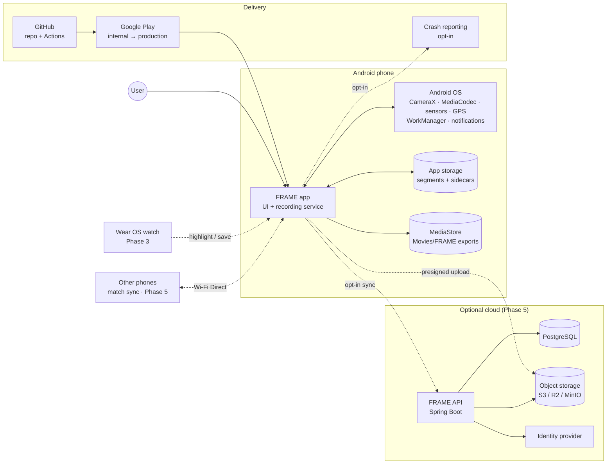
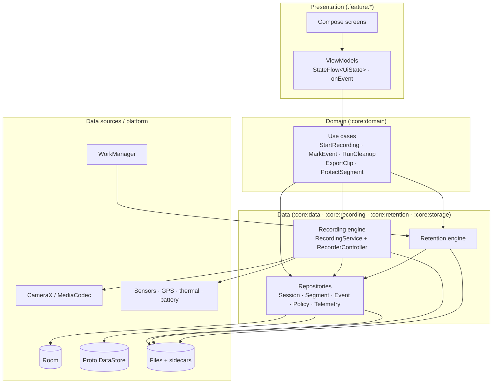
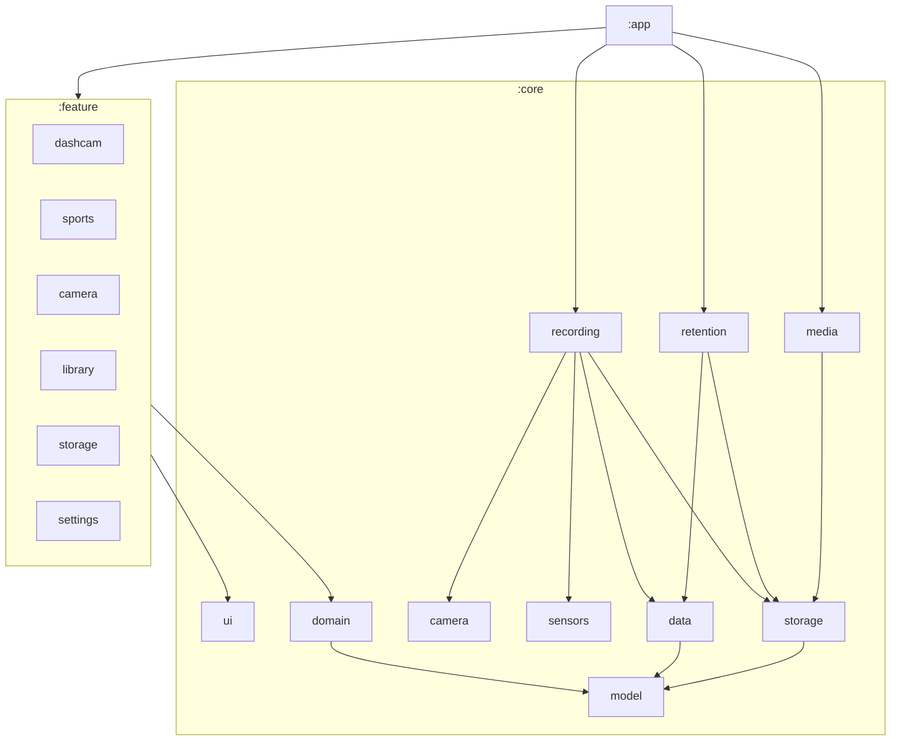
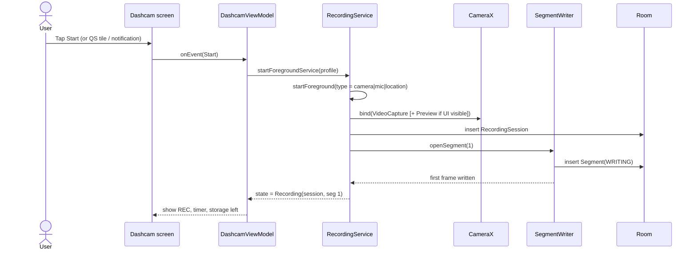
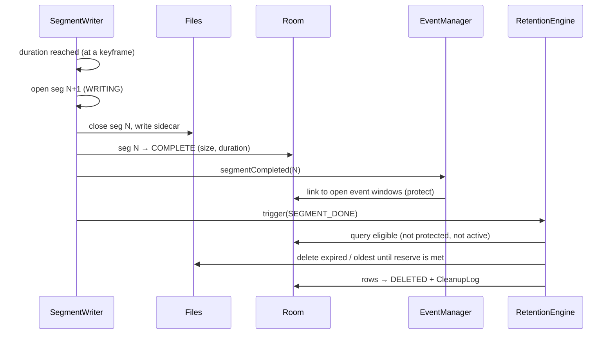
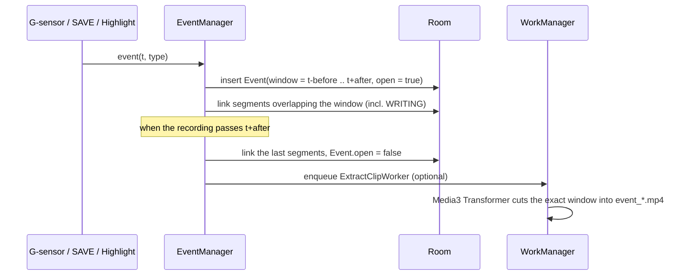
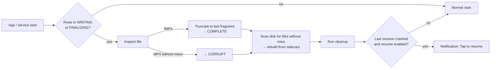
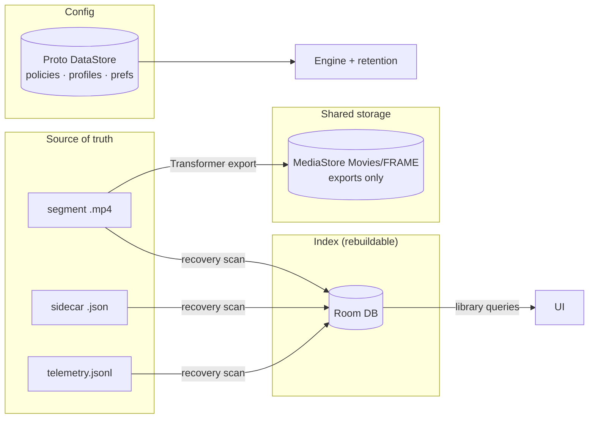
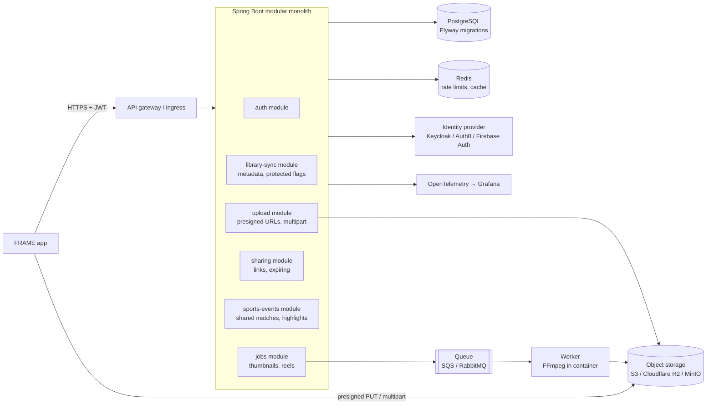
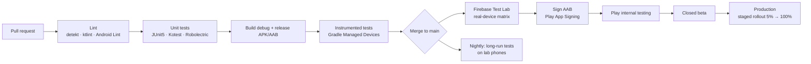

# 13 — End-to-end architecture plan

This plan covers FRAME from end to end: the Android app, the on-device recording engine, the optional cloud backend, CI/CD, observability and security. It shows how each piece grows from the POC to the full product. For engine internals (Gradle modules, threading, `RecorderController`), see [07-architecture.md](07-architecture.md). For every tool and library, see [14-tools-and-tech-stack.md](14-tools-and-tech-stack.md).

## 1. Architecture principles

| # | Principle | What it means in practice |
|---|---|---|
| P1 | **Local-first** | Recording, retention, library and export all work with no network and no account. The cloud is opt-in (Phase 5). |
| P2 | **Files are the source of truth** | Video files plus JSON sidecars hold the data. Room is an index that can be rebuilt from them. |
| P3 | **The engine outlives the UI** | Recording runs in a foreground service. Screens attach to it and detach from it. |
| P4 | **One engine, many modes** | Dashcam, Sports and Camera are *profiles* (settings + UI) on the same engine, not separate pipelines. |
| P5 | **Never lose protected footage** | Cleanup is a separate, testable component with hard rules: never delete protected or active segments. |
| P6 | **Fail loudly** | Every stop, step-down or error is logged and shown to the user. Nothing is silent. |
| P7 | **Modular and testable** | Feature modules depend on core modules only. Logic sits behind interfaces (`Clock`, `StorageStats`, `FileDeleter`) so it can run in unit tests. |
| P8 | **Native where it matters** | Camera, encoding and background work are native per platform. Shared logic can move to Kotlin Multiplatform when iOS starts. |

## 2. System context (end to end)

Solid lines exist in the POC. Dotted lines come in later phases.

## 3. On-device layered architecture

FRAME uses a **unidirectional data flow (UDF)** with a clean-architecture split. The recording engine is a long-lived service in the data layer.

| Layer | Responsibility | Depends on |
|---|---|---|
| Presentation | Rendering, user input, navigation; holds no business logic | Domain |
| Domain | Use cases: pure Kotlin, no Android types | Interfaces only |
| Data | Repositories, engines, mapping between entities and domain models | Platform APIs |
| Platform | Android SDK, CameraX, Room, WorkManager | — |

## 4. Module dependency graph

Rules, checked in CI by the Gradle `dependency-analysis` plugin and a module-graph assertion:

- `:feature:*` never depends on another `:feature:*`.
- `:core:domain` and `:core:model` have no Android dependencies (plain JVM modules).
- Only `:core:recording` touches CameraX and MediaCodec.

## 5. Key runtime flows

### 5.1 Start recording

### 5.2 Segment rollover and cleanup

### 5.3 Event protection (G-sensor, SAVE, highlight)

### 5.4 Crash recovery at startup

## 6. State management

- Each screen has one `UiState` data class, exposed as `StateFlow` from its ViewModel, plus one `onEvent(UiEvent)` entry point (MVI-style UDF).
- The engine exposes `StateFlow<RecorderState>` and `StateFlow<HealthStatus>`. ViewModels combine them with repository flows.
- One-off effects (snackbars, navigation) go through a `Channel` and are collected with `LaunchedEffect`.
- Configuration and process death: UI state is rebuilt from the service and the DB. The service holds the real recording state, so there's nothing to save in `SavedStateHandle` except form input.

## 7. Background execution model

| Work | Mechanism | Runs when |
|---|---|---|
| Recording | Foreground service `camera\|microphone\|location` with a persistent notification | During a session, screen on or off |
| Cleanup during recording | In-process coroutine (mutex) | After each segment, and on a low-space check |
| Cleanup while idle | `PeriodicWorkRequest` (1 h, flex 15 min) | Device idle-friendly |
| Event clip extraction, thumbnails, highlight reel | `OneTimeWorkRequest` with an expedited request for user-triggered exports | After events / on demand |
| Auto-start triggers | Broadcast receivers (power, Bluetooth ACL) → a high-priority notification | Charger / car BT connected |
| Upload / backup (Phase 5) | `WorkManager` with network + charging constraints, resumable | Opt-in only |

## 8. Data and storage architecture

- **Location:** app-specific external storage (`getExternalFilesDir`). No storage permission needed; only FRAME can delete these files.
- **Schema evolution:** Room auto-migrations with exported schemas checked into git, and a `MigrationTestHelper` test for every version.
- **Backup:** Android Auto Backup covers only DataStore settings. Videos are excluded (too big, and private).

## 9. Cloud backend architecture (Phase 5, optional)

The backend is **not needed for the POC**. When it comes, it is a Spring Boot modular monolith, which suits your Java background and keeps operations simple. The app never streams video through the API: it uploads straight to object storage using presigned URLs.

**Upload flow:**

1. The app asks `POST /uploads` for a segment, sending its hash and size.
2. The API returns presigned multipart URLs.
3. The app uploads the parts in the background with WorkManager, retrying and resuming.
4. The app calls `POST /uploads/{id}/complete`. The API verifies the hash and records the object.

**Sync model:** last-writer-wins on metadata (protected, favorite, labels), using per-field timestamps. Video objects are immutable.

**Privacy:** opt-in per mode or per clip, client-side encryption as an option (Phase 5+), and a region choice for EU users.

## 10. Security architecture

| Area | Control |
|---|---|
| Data at rest (device) | App-specific storage. Optional encryption of protected clips with Jetpack Security / Tink (AES-GCM, key in Android Keystore) in Phase 2. |
| Library access | Biometric / PIN app lock (`BiometricPrompt`) in Phase 2 |
| Evidence integrity | SHA-256 per segment, chained (`prevSha256`); verification screen + exported manifest |
| Exports | Location and audio stripped unless the user includes them; originals never shared directly |
| Network (Phase 5) | TLS 1.2+, certificate pinning optional, short-lived JWT access tokens + refresh tokens, presigned URLs that expire in 15 min |
| Backend | Spring Security, per-user row ownership checks, rate limiting, OWASP dependency check, secrets in a vault / cloud secret manager |
| Supply chain | Gradle dependency verification metadata, Renovate/Dependabot, app signing with Play App Signing |
| Permissions | Requested just in time with a rationale screen; app works (with reduced features) if location or audio is denied |

## 11. Observability

| Signal | On device | Backend (Phase 5) |
|---|---|---|
| Logs | Timber → rolling file (7 days), exportable zip from Settings | Structured JSON logs → Loki / CloudWatch |
| Session timeline | `recording_log` table (start, rollovers, thermal, errors) | — |
| Crashes / ANRs | Opt-in Crashlytics or Sentry; Android vitals in the Play Console | Sentry |
| Metrics | Debug HUD: FPS, bitrate, dropped frames, temperature, free space | Micrometer → Prometheus → Grafana |
| Tracing | Perfetto system traces during profiling | OpenTelemetry |
| Performance | Macrobenchmark + Baseline Profiles in CI | Load tests with k6 / Gatling |

## 12. CI/CD pipeline

| Stage | Tooling | Gate |
|---|---|---|
| Static analysis | detekt, ktlint (Spotless), Android Lint | No new warnings at error level |
| Unit tests | JUnit5, Kotest property tests, MockK, Turbine | Retention invariants 100% green; coverage at least 80% on `:core:retention` |
| UI / instrumented | Compose UI tests, Gradle Managed Devices (API 29, 34, 35) | Green |
| Real devices | Firebase Test Lab (Pixel, Samsung, Xiaomi) | Green on the smoke suite |
| Long-run (nightly) | `adb` harness + ffprobe on a self-hosted runner with phones attached | 8 h pass rate on the 3 reference phones |
| Release | Gradle Play Publisher or Fastlane `supply` | Manual approval for production |

## 13. Environments

| Environment | App build | Backend | Who |
|---|---|---|---|
| Local | `debug` (debug HUD, StrictMode, LeakCanary) | Docker Compose (Postgres, MinIO, Keycloak) | Developer |
| Internal | `internal` flavor, R8 on | Staging (Phase 5) | Team + testers |
| Beta | `release`, Play closed testing | Staging | Beta users |
| Production | `release`, staged rollout | Production | Everyone |

## 14. Architecture decision records (ADRs)

Each ADR gets a file in `docs/adr/` (`NNNN-title.md`: context, decision, consequences). Here is the first set:

| ADR | Decision | Status |
|---|---|---|
| 0001 | Native Android (Kotlin + Compose) first; no React Native / Flutter for the recorder | Accepted |
| 0002 | CameraX for capture; Camera2 interop only where needed | Accepted |
| 0003 | Segment writer: Option A (CameraX stop/start) now, Option B (MediaCodec + fMP4) behind a flag | Proposed (Week 1 spike) |
| 0004 | Files + sidecars are the source of truth; Room is a rebuildable index | Accepted |
| 0005 | Recordings in app-specific storage; exports through MediaStore | Accepted |
| 0006 | Protection derived from event links + manual flag (no stored PROTECTED state) | Accepted |
| 0007 | Media3 (Transformer, ExoPlayer, Muxer) instead of bundling FFmpeg on the device | Accepted |
| 0008 | Backend = Spring Boot modular monolith + PostgreSQL + S3-compatible storage; Phase 5 only | Proposed |
| 0009 | iOS via native Swift/AVFoundation; share domain logic with Kotlin Multiplatform if useful | Deferred |

## 15. How the architecture grows by phase

| Phase | Added to the architecture |
|---|---|
| POC / Phase 1 | Engine service, Room index, retention engine, Dashcam/Sports/Camera profiles, library, CI with unit and instrumented tests |
| Phase 2 | Hash chain, app lock, encryption of protected clips, parking-mode pipeline (time-lapse), incident PDF generator, kiosk/device-owner mode, Quick Share |
| Phase 3 | Camera2 manual controls layer, GPU analysis pipeline (histogram, peaking), Wear OS module (`:wear`) with the Data Layer API, profiles + schedules |
| Phase 4 | `:feature:studio` with a composition model (tracks, clips, effects) on Media3 Transformer, project files (JSON), undo/redo |
| Phase 5 | On-device ML (`:core:ml`: LiteRT, ML Kit, whisper.cpp), cloud backend + sync module (`:core:sync`), multi-phone sync over Wi-Fi Direct, RTMP streaming, iOS app |
