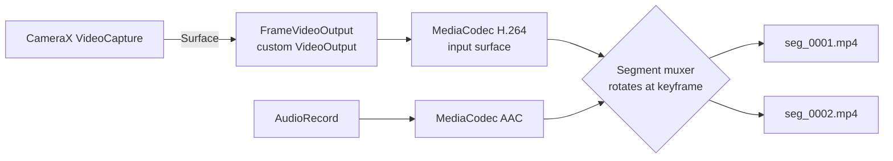

# 15 — Gapless segment writer: design and spike plan

The current writer (Option A) stops one CameraX recording and starts the next when a segment reaches its length. That loses about 0.3–1 s per boundary and, if the process is killed, the open segment has no `moov` box and is unplayable. Option B fixes both. It is **not built yet**: it depends on APIs that must be verified against a compiler and tuned on real phones, so it starts once the first APK builds.

## Design

1. **Custom `VideoOutput`.** `VideoCapture.withOutput(...)` accepts any `VideoOutput`. Its `onSurfaceRequested(SurfaceRequest)` provides the encoder's input surface, so CameraX, the overlay effect and the recording all keep working. The rotation comes from `SurfaceRequest.setTransformationInfoListener` and goes into `MediaMuxer.setOrientationHint`.
2. **Encoders keep running across segments.** Only the muxer changes. When a segment's time is up:
   - request a keyframe (`PARAMETER_KEY_REQUEST_SYNC_FRAME`);
   - when the next keyframe arrives, close the old muxer and open the new one;
   - write that keyframe as the first sample of the new file.

   Audio samples are all sync frames, so they move to the new muxer at the first audio timestamp at or after the video keyframe.
3. **Crash safety.** Phase 1 of the spike uses the framework `MediaMuxer`, which is stable API: it is gapless, but a killed process still loses the open segment. Phase 2 swaps in Media3 `FragmentedMp4Muxer`, which keeps the file playable up to the last fragment. Its API changed between Media3 1.5 and 1.6, so it must be checked against the pinned version.
4. **Same contract as today.** The engine keeps the same segment lifecycle (WRITING → COMPLETE), the same database rows and the same retention engine. Only `startSegment`/`onFinalized` change. A setting picks A or B, so A stays as the fallback.

## Must be verified (not knowable without a compiler and a phone)

| Question | How |
|---|---|
| Does `VideoCapture` accept a custom `VideoOutput` without a `MediaSpec` (resolution selection)? | Compile + bind on 3 devices |
| Does the encoder honour `REQUEST_SYNC_FRAME` within 1 frame on Pixel, Samsung, Xiaomi? | Log keyframe latency |
| Audio/video sync across a boundary | `ffprobe -show_frames` on both files, start PTS within 1 frame |
| Real gap | Timestamp continuity check: last PTS of N + frame time = first PTS of N+1 |
| `FragmentedMp4Muxer` API in the pinned Media3 | Compile against 1.5.x, or bump Media3 |

## Exit criteria

- 0 dropped frames across 100 consecutive 1-minute boundaries (test plan E2).
- Killed mid-segment: at most 2 s lost (E5).
- No regression in the retention tests or the library.
